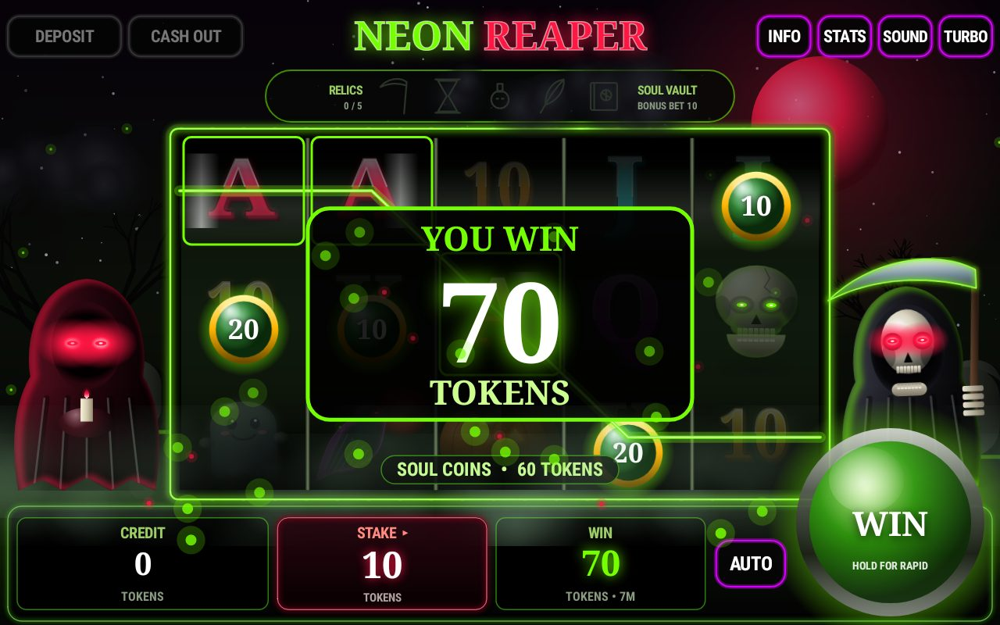
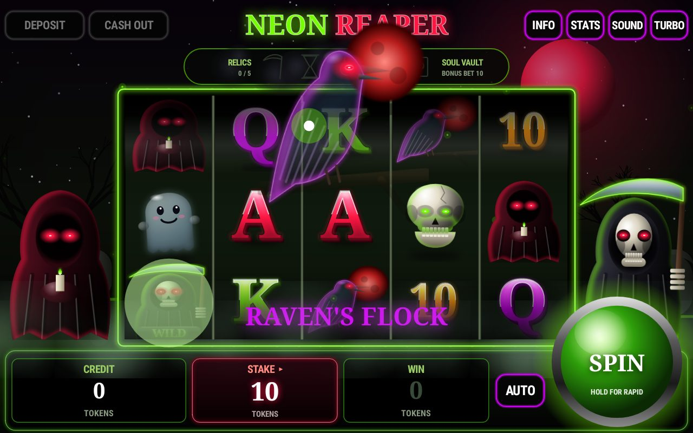

# Casino — Android slot machines

**Download the newest builds (open in your browser):**
- Neon Reaper: https://github.com/tjshea90/Casino/releases/latest/download/NeonReaper.apk
- Dragon's Hoard: https://github.com/tjshea90/Casino/releases/latest/download/DragonsHoard.apk
- If an .apk download sticks at 100 %, use the zip: [NeonReaper.zip](https://github.com/tjshea90/Casino/releases/latest/download/NeonReaper.zip) · [DragonsHoard.zip](https://github.com/tjshea90/Casino/releases/latest/download/DragonsHoard.zip) (extract in the Files app, tap the .apk)
- All builds: https://github.com/tjshea90/Casino/releases

| Game | APK | Theme |
|------|-----|-------|
| **Neon Reaper** | [`release/NeonReaper.apk`](release/NeonReaper.apk) (~250 KB) | Dark horror: reapers, hooded watchers, neon green & blood red. **94 % RTP**, Soul Vault bonus |
| **Dragon's Hoard** | [`release/DragonsHoard.apk`](release/DragonsHoard.apk) (~115 KB) | Red & gold Asian fortune. **94 % RTP**, free spins |

Both run on Android 10 (Go) and up (MT8168 / armv7 tested target), share the same currency and password security, and are separate apps (they can be installed side by side).

---

# Neon Reaper

- **Stake:** one STAKE button, 1–40 tokens (1, 2, 3, 4, 5, 8, 10, 15, 20, 25, 30, 40).
- **20 lines**, pays are whole multiples of the stake, so **every win is exact tokens**. Rounding down to a whole mack happens **only at cash-out** (odd tokens stay on the machine). Max win **25 books (2,000 tokens)** per spin and per bonus.
- **RTP 94 %** (stakes 1–10; the 25-book win cap trims it a little at higher stakes: 25 → 92.7 %, 40 → 90.9 %): over time the machine keeps **6 % of every token wagered**. About **1 spin in 3 wins** (33 %) and **every win pays at least your stake back**. See [`docs/MATH.md`](docs/MATH.md).
- Every win pops up a huge **"YOU WIN 70 TOKENS"**, can't be skipped until shown, and counts up with rising ticks for bigger wins (fanfare for big wins).
- **Giant SPIN button** — tap for one spin, **hold for rapid spins** until you let go.
- **Mini features (≈1 spin in 100):** a 3D character floats out in front of the reels — Reaper's Touch (wild reels), Raven's Flock (3–6 wilds), Pumpkin's Treats (3–6 soul coins worth their token value), Skull's Curse (2 wilds + ×2/×3/×5).
- **OpenGL ES 3 3D engine (v2.0):** real 3D reel drums, a moonlit graveyard (tombstones, dead trees, fog, fireflies, bats, lightning) and individually modelled Halloween characters with per-pixel lighting — a skull-faced Grim Reaper with a scythe, a red-eyed crimson Hooded Watcher holding a candle, a chattering skull, a cawing raven, a flickering jack-o'-lantern and a wailing ghost. Falls back to the 2D renderer on devices without OpenGL ES 3.
- **Reaper's Touch:** the Grim Reaper swoops in and slashes 1–3 middle reels fully wild.
- **Relics → Soul Vault bonus:** about 1 spin in 25 reveals one of 5 relics (kept between sessions). Collect all 5 (≈ every 125 spins) to open the **Soul Vault**, a separate hold-and-spin screen:
  its own epic soundtrack, 5 starting orbs, 3 respins (press SPIN for each) that reset whenever an orb lands; orbs worth 1×–25× the bonus bet; MINI 15×, MINOR 40×, MAJOR 150× jackpot orbs;
  the Reaper orb harvests every soul on the board; fill all 20 niches for the GRAND (1000×). Averages ~28× the bonus bet. The bonus bet is the **average stake of the five spins that revealed your relics, rounded down** — no pattern of stakes (big bets at the last relic, bets timed to relic count, mixing stakes) can earn a bigger bonus than the tokens you actually wagered.
- Big/Huge/Massive/Deadly win celebrations with the reaper rising, characters looming out of the reels on 5-of-a-kind, lightning, bats, fog, soul particles, synthesized horror music (separate bonus track) and sound effects.

| Reaper's Touch | Big win | Soul Vault |
|---|---|---|
|  |  |  |

| Pumpkin's Treats | Raven's Flock |
|---|---|
|  |  |

**Math verification** (`reaper/src/test/.../engine`): the RTP budget is *calculated exactly* — base game 59.34 % + mini features 11.98 % +
Soul Vault 22.68 % = **94.00 %** (`RtpExactTest`, `tools/reaper_model.py`) — and cross-checked against simulations of the real engine code
(`FullGameTest`: 4 M spins at each of 5 stakes, 94.05 / 93.99 / 93.89 / 92.84 / 90.87 % at stakes 1 / 5 / 10 / 25 / 40, hit rate 34 %).
`CalibrationTest` measures the 25-book cap per stake; `NoExploitTest` replays adaptive staking policies on the real engine and fails if
any beats 94 % (two earlier bonus-bet rules leaked 98 % and 101–104 % — found by testing and an independent audit, fixed, see `docs/MATH.md`).

---

# Dragon's Hoard

A fully offline, casino-style 5-reel video slot for Android 10 (Go edition) and up,
optimised for the MediaTek MT8168 (armv7). **APK: [`release/DragonsHoard.apk`](release/DragonsHoard.apk)** (~115 KB).

## Install (either game)
1. Copy the APK to the tablet (or download it from GitHub on the device).
2. Open it and allow "Install unknown apps" for your file manager/browser when asked.
3. Launch the game, set your machine password, then tap **DEPOSIT**.

## Currency
| Unit | Tokens |
|------|--------|
| 1 token | 1 |
| 1 mack | 10 tokens |
| 1 book | 8 macks = 80 tokens |

Bets are whole macks; every payout is rounded **down** to a whole mack.

## Password protection
- Deposits, cash-outs, password changes and machine reset all require the password.
- Password is stored only as a salted PBKDF2-SHA256 hash.
- The credit file is signed with an Android Keystore key; any outside edit puts the machine in **TILT** and disables play.
- 5 wrong passwords → lockout starting at 30 s, doubling up to 1 hour.
- App backup / device transfer is disabled so an old balance can't be restored.
- There is no password recovery (by design).

## The game
- 5 reels × 3 rows, 10 paylines, choose 1–10 lines and 1–40 macks per line.
- **Dragon Wild** substitutes for everything except the scatter; 5 wilds on a line pay 1,000× the line bet.
- **Tiger and Koi pay for a pair** (1× the line bet); wild substitutes.
- **Gold Coin Scatter** pays anywhere (2× / 10× / 50× total bet); 3+ award free spins with **all wins ×3** — **3 scatters = 10, 4 = 15, 5 = 25 spins** — retriggerable, on richer reels.
- Real-cabinet behaviour: reel anticipation ("tease") when 2 scatters land, slam-stop, win roll-ups,
  BIG / SUPER / MEGA / EPIC win celebrations with coin showers, chasing lights, autoplay, turbo, synthesized sounds, haptics.

## Math (verified by unit tests)
| | |
|---|---|
| Theoretical RTP | **94.00 %** (exact: 93.996 %, house edge 6 %) — identical at every bet and line count |
| Base-game line wins | 59.0 % |
| Scatter pays | 2.2 % |
| Free-spin feature | 32.7 % (triggers ~1 in 109 spins, ≈ 11.4 spins, averages ~36× total bet) |
| Hit frequency (10 lines) | 43.9 % any win (1 in 2.3); 16.3 % (1 in 6.1) return at least the whole stake |
| Volatility | Medium (SD ≈ 5.5 × bet) |

`app/src/test/.../RtpTest.kt` computes the RTP exactly over every reel combination (±0.02 %), checks it never exceeds 94 %, and runs a
3-million-spin Monte-Carlo simulation of the full game (94.05 %). Wins smaller than your whole stake (pair/low pays on many lines) play only a quiet chime.
Method, sources and the exact numbers: [`docs/MATH.md`](docs/MATH.md).

| Win presentation | Big win |
|---|---|
|  |  |

## Build
See `HANDOFF.md`. `gradle :app:testDebugUnitTest :app:assembleRelease`. GitHub Actions also builds the APK on every push.
