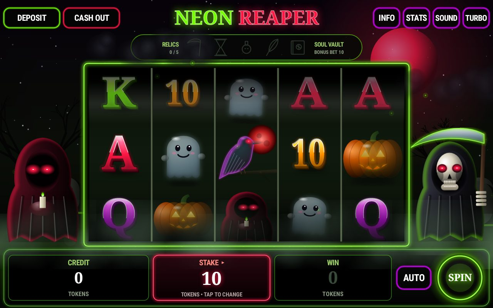
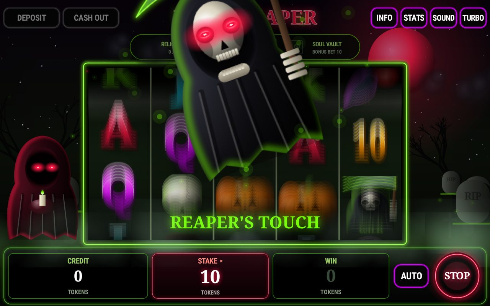
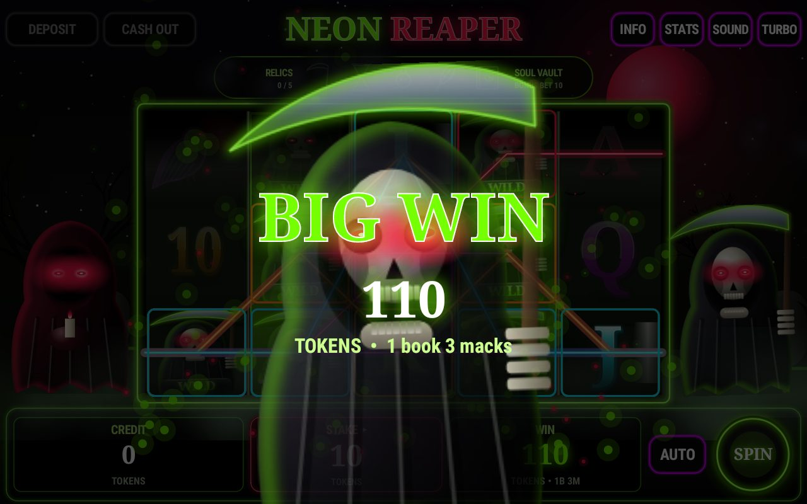
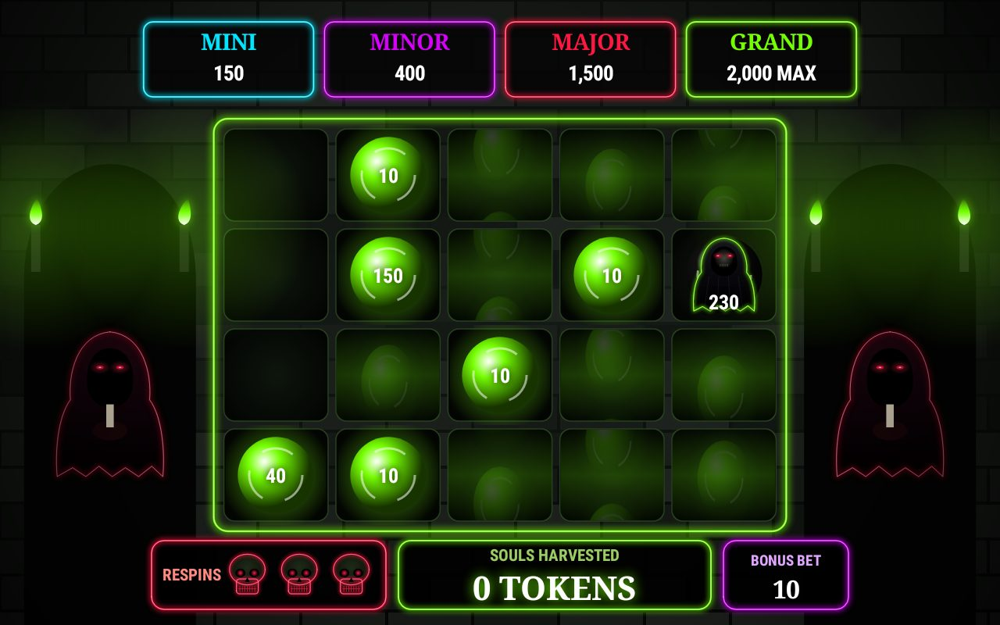
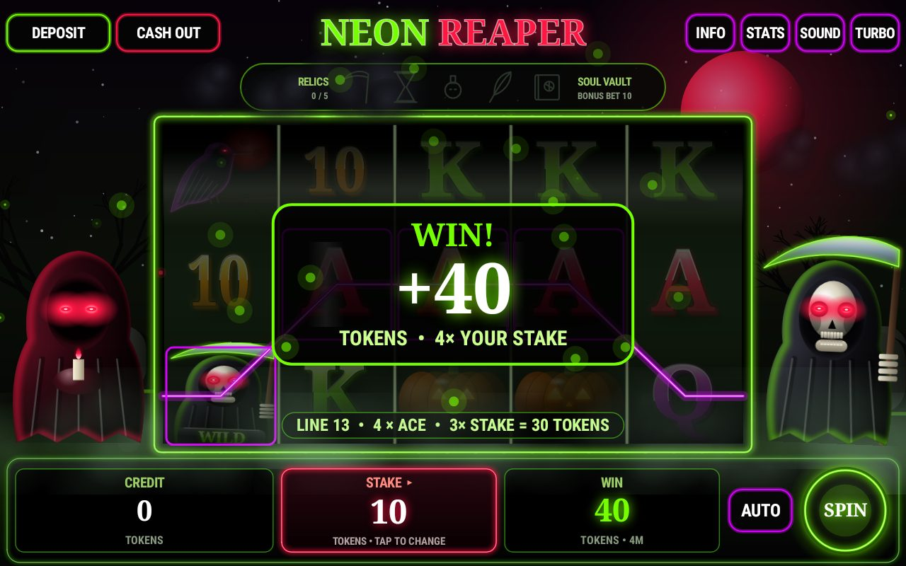
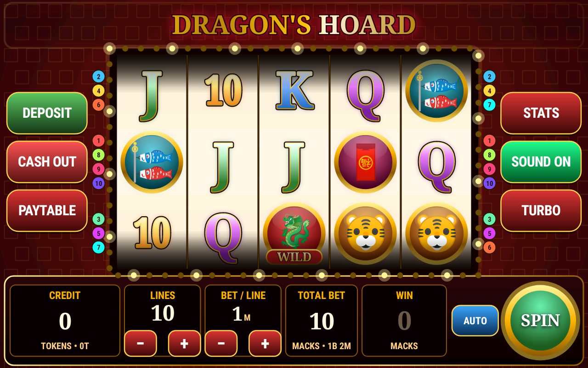
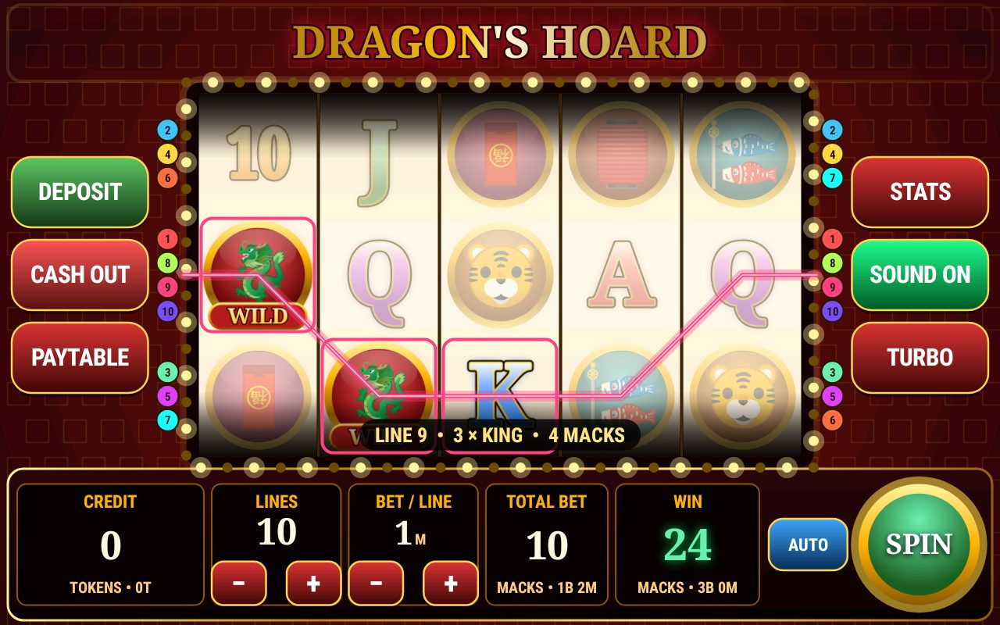
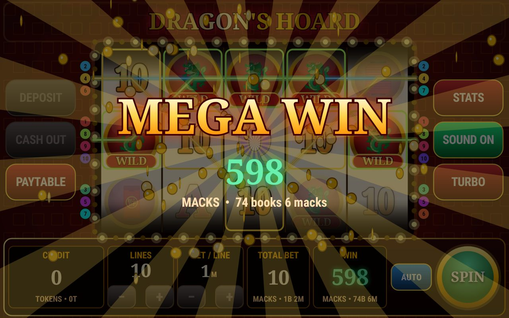

# Casino — Android slot machines

**Download the newest builds (open in your browser):**
- Neon Reaper: https://github.com/tjshea90/Casino/releases/latest/download/NeonReaper.apk
- Dragon's Hoard: https://github.com/tjshea90/Casino/releases/latest/download/DragonsHoard.apk
- All builds: https://github.com/tjshea90/Casino/releases

| Game | APK | Theme |
|------|-----|-------|
| **Neon Reaper** | [`release/NeonReaper.apk`](release/NeonReaper.apk) (~150 KB) | Dark horror: reapers, hooded watchers, neon green & blood red. 87 % RTP, Soul Vault bonus |
| **Dragon's Hoard** | [`release/DragonsHoard.apk`](release/DragonsHoard.apk) (~115 KB) | Red & gold Asian fortune. 80 % RTP, free spins |

Both run on Android 10 (Go) and up (MT8168 / armv7 tested target), share the same currency and password security, and are separate apps (they can be installed side by side).

---

# Neon Reaper

- **Stake:** one STAKE button, 1–40 tokens (1, 2, 3, 4, 5, 8, 10, 15, 20, 25, 30, 40).
- **20 lines**, pays are whole multiples of the stake, so **every win is exact tokens**. Rounding down to a whole mack happens **only at cash-out** (odd tokens stay on the machine). Max win **25 books (2,000 tokens)** per spin and per bonus.
- **RTP 87 % at every stake** (house edge 13 %). About **1 spin in 3.4 wins** at every stake. Every win pauses with a big token amount and a sound (autoplay too).
- **3D graphics:** curved 3D reel drum and lit 3D characters with animated faces — red-eyed Grim Reaper and Hooded Watcher, a laughing chattering skull, a cawing raven, a grinning jack-o'-lantern and a giggling ghost. Characters come alive at random with their own voices.
- **Reaper's Touch:** the Grim Reaper swoops in and slashes 1–3 middle reels fully wild.
- **Relics → Soul Vault bonus:** about 1 spin in 24 reveals one of 5 relics (kept between sessions). Collect all 5 (≈ every 120 spins) to open the **Soul Vault**, a separate hold-and-spin screen:
  5 starting orbs, 3 respins that reset whenever an orb lands; orbs worth 1×–25× the bonus bet; MINI 15×, MINOR 40×, MAJOR 150× jackpot orbs;
  the Reaper orb harvests every soul on the board; fill all 20 niches for the GRAND (1000×). Averages ~28× the bonus bet. The bonus bet is your **average stake while collecting**, so switching to a big stake at the last relic doesn't game it.
- Big/Huge/Massive/Deadly win celebrations with the reaper rising, characters looming out of the reels on 5-of-a-kind, lightning, bats, fog, soul particles, synthesized horror music (separate bonus track) and sound effects.

| Reaper's Touch | Big win | Soul Vault |
|---|---|---|
|  |  |  |

**Math verification** (`reaper/src/test/.../CalibrationTest.kt`, `FullGameTest.kt`): per-stake RTP is measured with rounding and the cap
(4 M base spins, 800 k feature spins, 400 k bonuses); the Reaper's Touch rate is tuned per stake so each stake computes to 87.0 %.
A 2-million-spin full-game simulation per stake confirms 87.0–87.6 % with a 29 % hit rate.

---

# Dragon's Hoard

A fully offline, casino-style 5-reel video slot for Android 10 (Go edition) and up,
optimised for the MediaTek MT8168 (armv7). **APK: [`release/DragonsHoard.apk`](release/DragonsHoard.apk)** (~115 KB).

## Install (either game)
1. Copy the APK to the tablet (or download it from GitHub on the device).
2. Open it and allow "Install unknown apps" for your file manager/browser when asked.
3. Launch the game, set your machine password, then tap **DEPOSIT**.

## Currency
| Unit | Tokens |
|------|--------|
| 1 token | 1 |
| 1 mack | 10 tokens |
| 1 book | 8 macks = 80 tokens |

Bets are whole macks; every payout is rounded **down** to a whole mack.

## Password protection
- Deposits, cash-outs, password changes and machine reset all require the password.
- Password is stored only as a salted PBKDF2-SHA256 hash.
- The credit file is signed with an Android Keystore key; any outside edit puts the machine in **TILT** and disables play.
- 5 wrong passwords → lockout starting at 30 s, doubling up to 1 hour.
- App backup / device transfer is disabled so an old balance can't be restored.
- There is no password recovery (by design).

## The game
- 5 reels × 3 rows, 10 paylines, choose 1–10 lines and 1–40 macks per line.
- **Dragon Wild** substitutes for everything except the scatter; 5 wilds on a line pay 1,000× the line bet.
- **Gold Coin Scatter** pays anywhere (2× / 10× / 50× total bet); 3+ award **10 free spins with all wins ×3**, retriggerable, on richer reels.
- Real-cabinet behaviour: reel anticipation ("tease") when 2 scatters land, slam-stop, win roll-ups,
  BIG / SUPER / MEGA / EPIC win celebrations with coin showers, chasing lights, autoplay, turbo, synthesized sounds, haptics.

## Math (verified by unit tests)
| | |
|---|---|
| Theoretical RTP | **80.00 %** (exact: 79.999 %) — identical at every bet |
| Base-game line wins | 53.7 % |
| Scatter pays | 1.9 % |
| Free-spin feature | 24.4 % (triggers ~1 in 126 spins, averages ~31× total bet) |
| Hit frequency (10 lines) | ~33 % |
| Volatility | Medium (SD ≈ 4.6 × bet) |

`app/src/test/.../RtpTest.kt` computes the RTP exactly over every reel combination and also runs a
3-million-spin Monte-Carlo simulation of the full game.

| Win presentation | Big win |
|---|---|
|  |  |

## Build
See `HANDOFF.md`. `gradle :app:testDebugUnitTest :app:assembleRelease`. GitHub Actions also builds the APK on every push.
