# Casino — Android slot machines

**Download the newest builds (open in your browser):**
- Neon Reaper: https://github.com/tjshea90/Casino/releases/latest/download/NeonReaper.apk
- Dragon's Hoard: https://github.com/tjshea90/Casino/releases/latest/download/DragonsHoard.apk
- If an .apk download sticks at 100 %, use the zip: [NeonReaper.zip](https://github.com/tjshea90/Casino/releases/latest/download/NeonReaper.zip) · [DragonsHoard.zip](https://github.com/tjshea90/Casino/releases/latest/download/DragonsHoard.zip) (extract in the Files app, tap the .apk)
- All builds: https://github.com/tjshea90/Casino/releases

| Game | APK | Theme |
|------|-----|-------|
| **Neon Reaper** | [`release/NeonReaper.apk`](release/NeonReaper.apk) (~550 KB) | **3.0 "DREAD"** — gothic horror 3D slot: Grim Reaper, Plague Doctor, Cursed Skull, Blood Raven, Demon, Wraith, haunted coffins. **94 % RTP**, THE SÉANCE free spins, Soul Vault bonus, feature buy |
| **Dragon's Hoard** | [`release/DragonsHoard.apk`](release/DragonsHoard.apk) (~115 KB) | Red & gold Asian fortune. **94 % RTP**, free spins |

Both run on Android 10 (Go) and up (MT8168 / armv7 tested target), share the same currency and password security, and are separate apps (they can be installed side by side).

---

# Neon Reaper 3.0 — DREAD

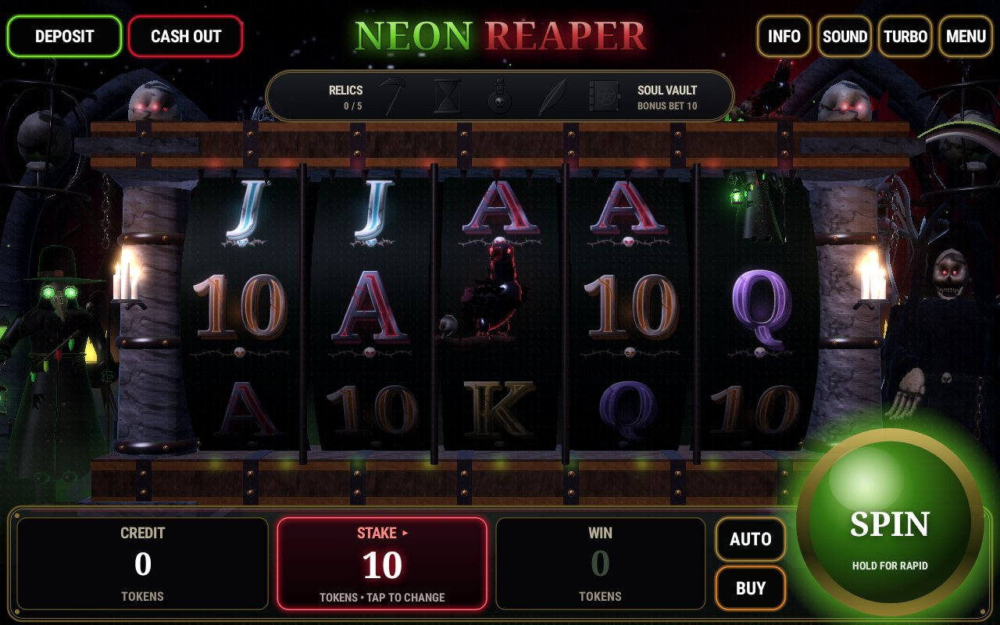

A dark, scary 3D video slot (OpenGL ES 3 engine behind a Canvas HUD, Android 10 Go → Android 16, auto quality tiers for weak GPUs). The reels are drawn in a crypt cabinet of carved
pillars, iron-strapped beams, burning skulls and chained cages; the cast are real animated 3D models with per-pixel lighting, bloom, fog and a blood-red mood in the bonus.

- **Stake:** one STAKE button, 1–40 tokens (1, 2, 3, 4, 5, 8, 10, 15, 20, 25, 30, 40). **20 lines**, every payout is a whole number of tokens; rounding to a whole mack happens only at cash-out.
- **Cast:** Grim Reaper (wild), Plague Doctor, Cursed Skull, Blood Raven, Demon, Wraith, carved A K Q J 10, and the **Coffin** scatter.
- **RTP 94 %** (stakes 1–5; the 25-book win cap trims it at high stakes: ≈ 93.8 % at 10, ≈ 92 % at 25, ≈ 89 % at 40) → the house keeps **6 % of every token wagered, whatever you do**. Plain spins win 1 time in 3.2 and **every win pays at least your stake back**.
  See [`docs/MATH.md`](docs/MATH.md) (PAR sheet) and the independent audit [`docs/AUDIT_v3.md`](docs/AUDIT_v3.md).
- **Win tiers:** SOUL REAPED (10×), DEATH'S TOLL (25×), HELLFIRE (50×), APOCALYPSE (100×) — one stinger per tier, the title slams in on the hit. Big wins count up with rising ticks and can't be skipped until shown.
- **Anticipation:** when two coffins land the remaining reels slow down, the room reddens and a heartbeat builds (it only ever reflects what really landed).
- **Mini features (about 1 spin in 154):** Reaper's Touch (wild reels), Murder of Crows (wilds), Demon's Bargain (soul coins worth tokens), Skull's Curse (wilds + ×2/×3/×5), each performed by its 3D character.

| THE SÉANCE | Free spins, multiplier ×1…×10 | Feature Buy |
|---|---|---|
| 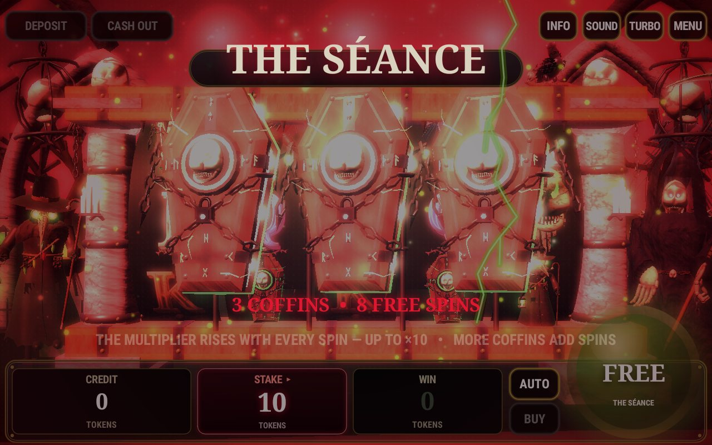 | 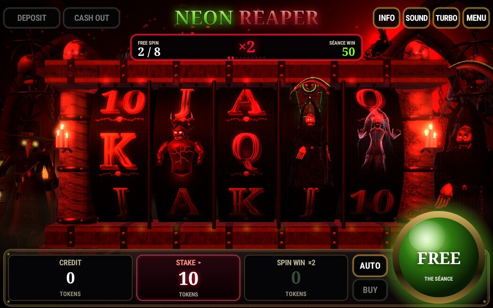 | 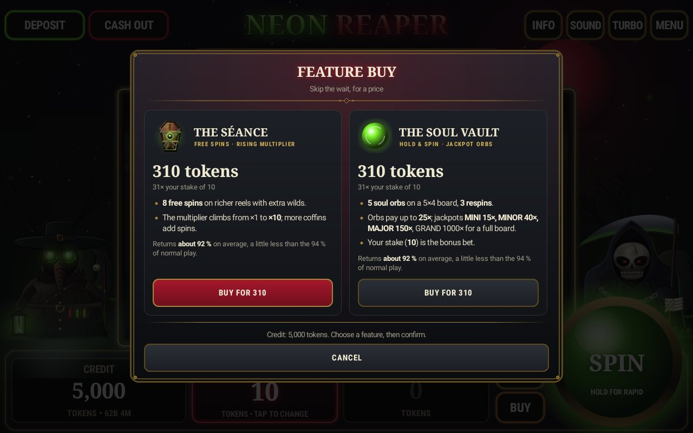 |

- **THE SÉANCE** (coffins anywhere: 3 / 4 / 5 pay 2× / 10× / 50× your stake **and** give 8 / 12 / 20 free spins, about 1 round in 213 spins, ≈ 30× stake on average): giant chained coffins rise and burst open, the music turns,
  free spins play on richer reels with a **multiplier that climbs ×1, ×2 … ×10**, more coffins add spins, and a closing tally counts the total. The round is paid and saved with the trigger, so it replays identically after a crash.
- **Relics → Soul Vault:** about 1 spin in 27 reveals one of 5 relics (kept between sessions). With all five the **Soul Vault** opens — a hold-and-respin crypt: 5 starting soul orbs, 3 respins that reset when an orb lands,
  orbs worth 1×–25× the bonus bet, MINI 15× / MINOR 40× / MAJOR 150× jackpot skulls, the Reaper orb harvests every soul, fill the board for the GRAND (1000×); about 28× the bonus bet on average.
  The bonus bet is the **average stake of the five relic-revealing spins, rounded down** — no staking pattern can make it worth more than the tokens you actually wagered.
- **Feature Buy:** skip the wait — THE SÉANCE or the SOUL VAULT for 31× your stake. Priced above their exact expected payout (they return about 92.8 % / 91.5 %, **less** than normal play), and a bought round that pays back less than it cost is never celebrated.

| Reaper's Touch | Demon's Bargain | Big win |
|---|---|---|
| 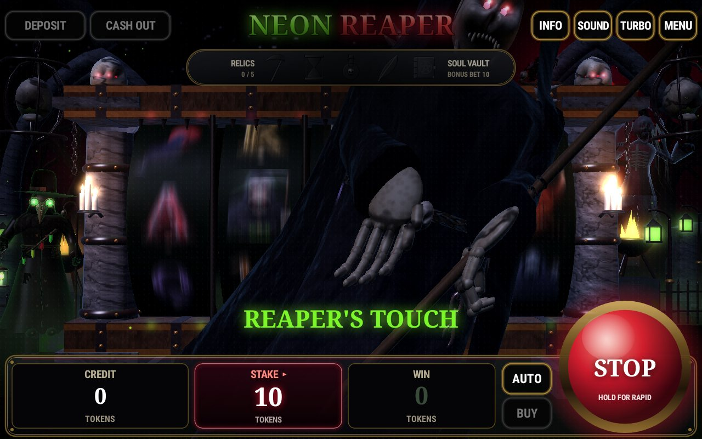 | 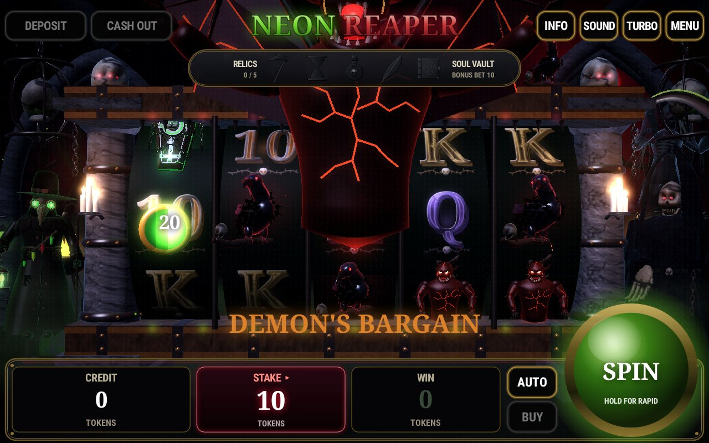 | 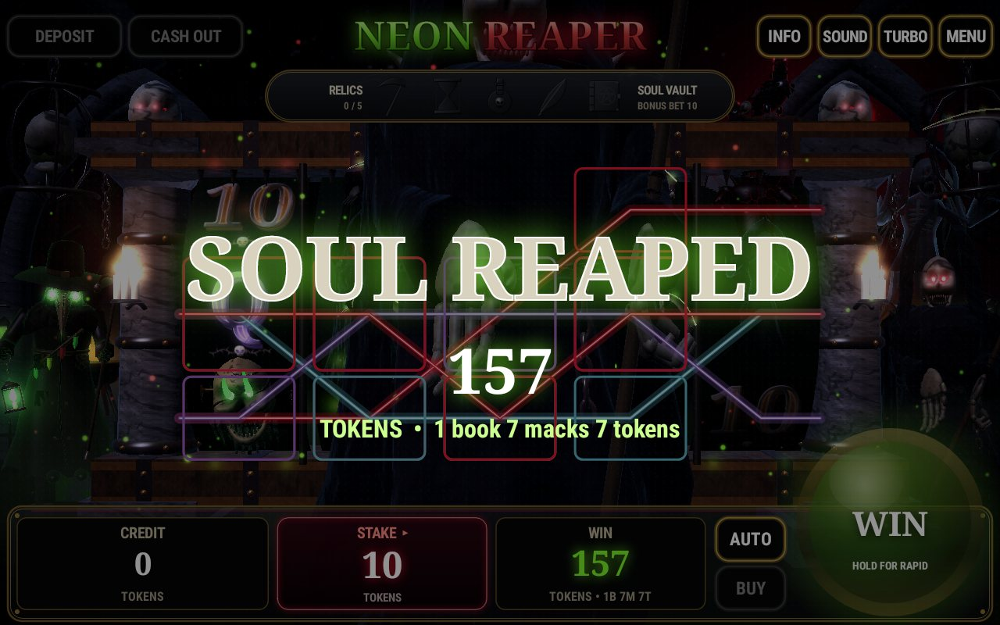 |

| Soul Vault | The vault pays |
|---|---|
| 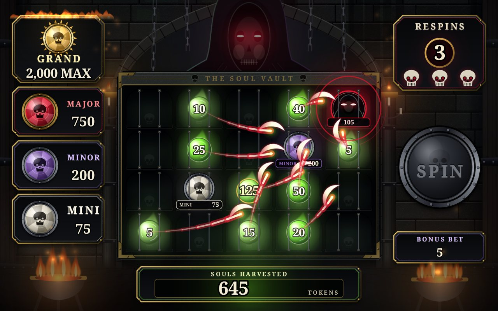 | 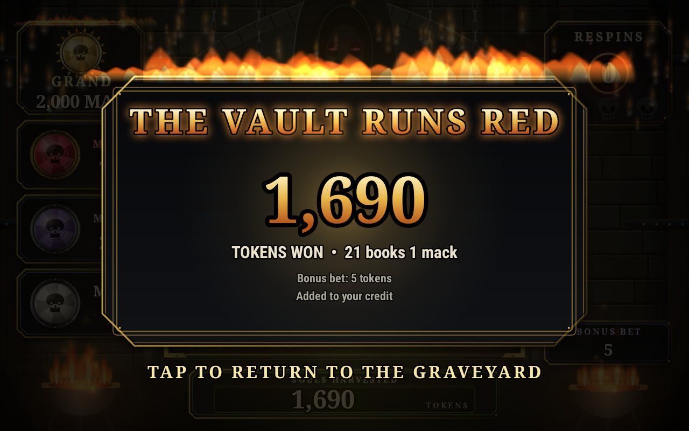 |

- **Sound:** a fully procedural dark score (BASE / SÉANCE / VAULT, layers that fade in with the action) and 74 effects, rendered on first launch and cached (no audio assets in the APK).
- **Player protection (like regulated brands):** session time, wagered, won and net result in Stats; a **reality check** every 30 minutes (15 / 30 / 60 / off); **autoplay limits** (stop on a single win of N× stake, stop when credit drops by N %);
  a **reduce flashing** option; no "losses disguised as wins", no free-credit promos, no progressive jackpots. Rank and the Reaper's Ledger (achievements) are purely cosmetic.
- **Controls:** giant SPIN (tap, or hold for rapid), AUTO, BUY, STAKE, TURBO, SOUND, INFO (pay table & rules), MENU (settings: quality, flashing, reality check, volumes, rank & ledger, statistics).
  Deposits, cash-outs and password changes need the machine password (same security model as Dragon's Hoard: PBKDF2 hash, signed credit file, TILT on tampering).

**Math verification** (`reaper/src/test/.../engine`): the RTP budget is *calculated exactly* — base game + minis 57.77 % + coffin pays 1.11 % + THE SÉANCE 14.12 % + Soul Vault 21.00 % = **94.00 %**
(`RtpExactTest`, `tools/reaper_model.py`) — and cross-checked against simulations of the real engine (`FullGameTest`, `CalibrationTest` measures the 25-book cap per stake, `NoExploitTest` replays adaptive staking / buying policies).
An independent audit (`docs/AUDIT_v3.md`, `tools/audit/`, `*Audit*Test`) enumerated all 2.2·10⁹ reel combinations and could not beat the house with any staking, buying, timing, rounding, crash or file-edit trick.

---

# Dragon's Hoard

A fully offline, casino-style 5-reel video slot for Android 10 (Go edition) and up,
optimised for the MediaTek MT8168 (armv7). **APK: [`release/DragonsHoard.apk`](release/DragonsHoard.apk)** (~115 KB).

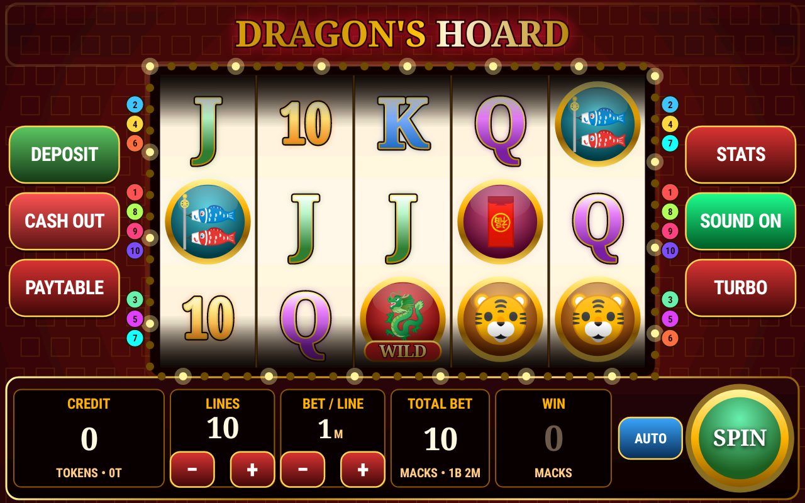

## Install (either game)
1. Copy the APK to the tablet (or download it from GitHub on the device).
2. Open it and allow "Install unknown apps" for your file manager/browser when asked.
3. Launch the game, set your machine password, then tap **DEPOSIT**.

## Currency
| Unit | Tokens |
|------|--------|
| 1 token | 1 |
| 1 mack | 10 tokens |
| 1 book | 8 macks = 80 tokens |

Bets are whole macks; every payout is rounded **down** to a whole mack.

## Password protection
- Deposits, cash-outs, password changes and machine reset all require the password.
- Password is stored only as a salted PBKDF2-SHA256 hash.
- The credit file is signed with an Android Keystore key; any outside edit puts the machine in **TILT** and disables play.
- 5 wrong passwords → lockout starting at 30 s, doubling up to 1 hour.
- App backup / device transfer is disabled so an old balance can't be restored.
- There is no password recovery (by design).

## The game
- 5 reels × 3 rows, 10 paylines, choose 1–10 lines and 1–40 macks per line.
- **Dragon Wild** substitutes for everything except the scatter; 5 wilds on a line pay 1,000× the line bet.
- **Tiger and Koi pay for a pair** (1× the line bet); wild substitutes.
- **Gold Coin Scatter** pays anywhere (2× / 10× / 50× total bet); 3+ award free spins with **all wins ×3** — **3 scatters = 10, 4 = 15, 5 = 25 spins** — retriggerable, on richer reels.
- Real-cabinet behaviour: reel anticipation ("tease") when 2 scatters land, slam-stop, win roll-ups,
  BIG / SUPER / MEGA / EPIC win celebrations with coin showers, chasing lights, autoplay, turbo, synthesized sounds, haptics.

## Math (verified by unit tests)
| | |
|---|---|
| Theoretical RTP | **94.00 %** (exact: 93.996 %, house edge 6 %) — identical at every bet and line count |
| Base-game line wins | 59.0 % |
| Scatter pays | 2.2 % |
| Free-spin feature | 32.7 % (triggers ~1 in 109 spins, ≈ 11.4 spins, averages ~36× total bet) |
| Hit frequency (10 lines) | 43.9 % any win (1 in 2.3); 16.3 % (1 in 6.1) return at least the whole stake |
| Volatility | Medium (SD ≈ 5.5 × bet) |

`app/src/test/.../RtpTest.kt` computes the RTP exactly over every reel combination (±0.02 %), checks it never exceeds 94 %, and runs a
3-million-spin Monte-Carlo simulation of the full game (94.05 %). Wins smaller than your whole stake (pair/low pays on many lines) play only a quiet chime.
Method, sources and the exact numbers: [`docs/MATH.md`](docs/MATH.md).

| Win presentation | Big win |
|---|---|
| 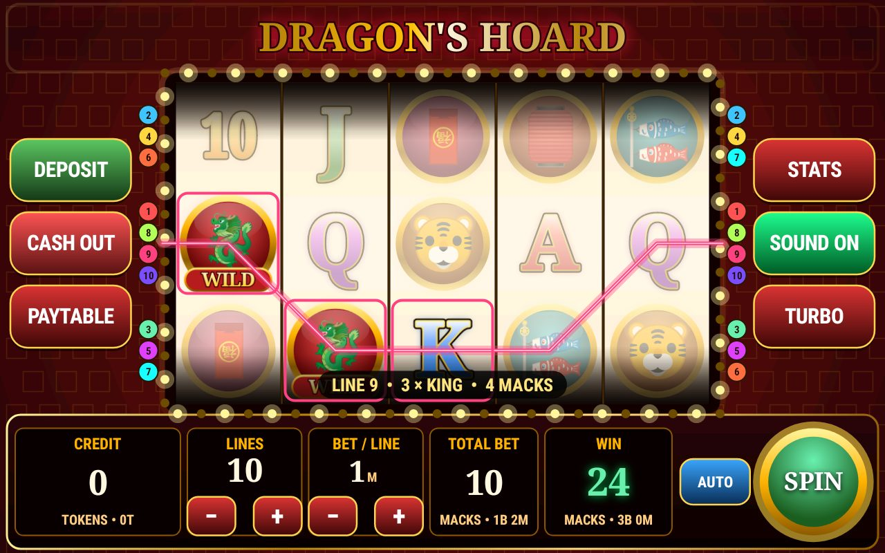 | 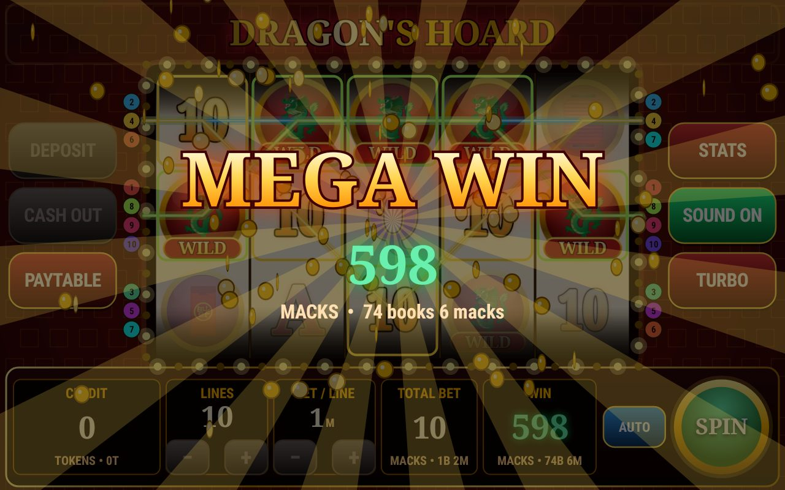 |

## Build
See `HANDOFF.md`. `gradle :app:testDebugUnitTest :app:assembleRelease`. GitHub Actions also builds the APK on every push.
